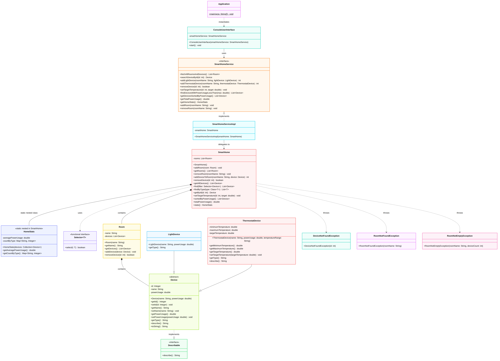
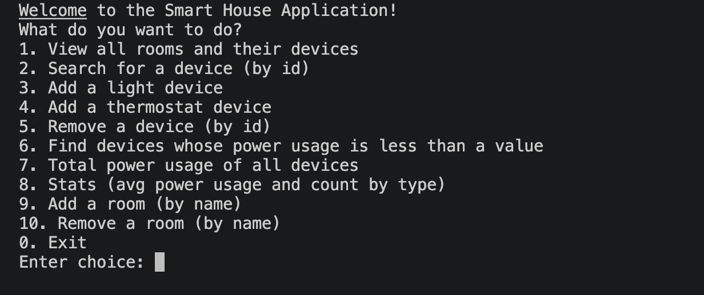

# Smart Home – final assignment OOP1

## Contents
1. [The assignment](#the-assignment)
2. [Class diagram](#class-diagram)
3. [Console user interface](#console-user-interface)
4. [Business rules](#business-rules)
5. [Open points: you decide](#open-points-you-decide)
6. [Unit tests](#unit-tests)
7. [Documentation](#documentation)
8. [Working with AI (spec-driven)](#working-with-ai-spec-driven)
9. [Git](#git)
10. [What to hand in](#what-to-hand-in)
11. [Grading](#grading)

## The assignment
You will build a console application that manages **one** smart home: rooms, the devices in those rooms,
their power usage and some statistics.
The application keeps everything in memory: when you exit, all data is lost. The home starts empty
(no rooms, no devices).

You are expected to use AI tooling. The specification below is **deliberately not complete**:
part of the assignment is finding the gaps, deciding how to fill them and recording those decisions
(see [Open points](#open-points-you-decide) and `DECISIONS.md`). 

## Class diagram

Notes on the diagram:
- Exceptions thrown by a method are not shown in the diagram; see [Business rules](#business-rules).
- The diagram shows the **required** public API. You may add private helper methods, and extra public
  methods if you can justify them in `DECISIONS.md`. Do not rename or remove anything.
- Packages are not shown: organising the classes into packages is part of the assignment.
  The base package is `nl.inholland.oop1`.

## Console user interface
The menu looks like this:

The user interface must never crash on wrong input (text instead of a number, an unknown id,
an invalid temperature range, ...). It shows a clear message and returns to the menu.

## Business rules

### Devices
- Every device has a name and a power usage in watts (`powerUsage`).
  A new device has **no id** (`null`) until it is added to a room.
- Validation (constructor and setters): reject `null` or empty names and negative power usage
  with an `IllegalArgumentException`.
- `getType()` returns `"Light"` for a `LightDevice` and `"Thermostat"` for a `ThermostatDevice`.
- `describe()` returns `| id: <id> || name: <name> || type: <type> |`.
  A thermostat adds its range and target temperature in the same style.
- `toString()` returns exactly the result of `describe()`.

### Thermostat
- The constructor receives the temperature range as a String in the format `"<min>-<max>"`,
  for example `"16-24"` or `"16.5-23.5"`.
- The range must not be empty, must lie within 5 and 30 °C (inclusive) and `min` must be lower
  than `max`. Anything else results in an `IllegalArgumentException`.
- A new thermostat has its minimum temperature as target temperature.
- `setTargetTemperature` rejects targets outside the range with an `IllegalArgumentException`.

### Rooms
- A room has a unique name.
- `Room.getDevices()` must not allow callers to change the devices of the room.
- A room that still contains devices **cannot be removed**: `removeRoom` throws a `RoomNotEmptyException`.
- Using a room name that does not exist throws a `RoomNotFoundException`.

### SmartHome
- `addDeviceToRoom(roomName, device)` generates a new id: the highest existing id **across all rooms** + 1.
  It assigns this id to the device, ignoring any pre-set id, and returns it.
- `removeDevice(id)` returns `true` if a device was removed, `false` otherwise.
- `getById(id)` throws a `DeviceNotFoundException` when there is no such device.
- `getAllDevices()` returns a new list (never `null`).
- `find(filter)` returns a new list with the matching devices. Throws a `NullPointerException` if the filter is `null`.
- `findByType(type)` is a **generic method**: `findByType(ThermostatDevice.class)` returns a
  `List<ThermostatDevice>`.
- `setTargetTemperature(id, target)` on a device that is not a thermostat is an error.
- `sortedByPowerUsage()` returns all devices, highest power usage first. Devices with equal
  usage are sorted by name.
- `totalPowerUsage()` is the sum of the power usage of all devices.
- `stats()` returns a snapshot `HomeStats` based on the current devices only (no history).

### HomeStats (static nested class of SmartHome)
- `getAveragePowerUsage()`: arithmetic mean of the power usage; `0.0` if there are no devices.
- `getCountByType()`: number of devices per device type.

### Lambdas and anonymous classes
- Use lambdas or method references where they make the code clearer (for example with `find` and
  for sorting).
- Implement at least one `Selector` somewhere in your code as an **anonymous class**, and explain in
  `DECISIONS.md` when you would choose one over the other.

### Exceptions
- All custom exceptions are **checked** exceptions.
- The messages are:
  - `DeviceNotFoundException`: `Device with id '<id>' not found.`
  - `RoomNotFoundException`: `Room '<name>' not found.`
  - `RoomNotEmptyException`: `Room '<name>' still contains <n> device(s).`

### General rules
- All collections returned are non-null (empty if there are no results).
- `SmartHomeServiceImpl` gets its `SmartHome` through the constructor; `Application` creates and
  connects all objects.

## Open points: you decide
The specification does not answer every question. A few examples you must decide on yourself:
- Which exception is thrown for `setTargetTemperature` on a device that is not a thermostat?
- What is the id of the first device in an empty home?
- Does `getCountByType()` contain an entry for a type that has no devices?

**This list is not complete.** Read the specification critically (or let your AI tool do it) and find
the other gaps. For every open point, record in `DECISIONS.md` the question, your decision, why, and
which test proves it. Finding gaps yourself counts towards the *Spec driven* criterion.

## Unit tests
- Write unit tests (JUnit) for all classes except `ConsoleUserInterface` and `Application`.
- Deciding which cases, edge cases and branches need a test is part of the assignment.
- Test `SmartHomeServiceImpl` in isolation by **mocking** `SmartHome` with Mockito.
- Check your coverage with `mvn verify` and open `target/site/jacoco/index.html`.

## Documentation
- Every public class and every public method has Javadoc that describes what it does, its parameters,
  its return value and the exceptions it throws.
- `mvn javadoc:javadoc` must run without errors.

## Working with AI (spec-driven)
You may use any AI tool. We grade **how** you use it, not whether the code was typed by you.
Make your way of working visible in the repository, for example:
- a specification or plan that you wrote (with AI) **before** generating code, e.g. `docs/spec.md`;
- instruction files for your tool (`AGENTS.md`, `CLAUDE.md`, `.github/copilot-instructions.md`, ...),
  skills, custom commands or agents;
- `DECISIONS.md` with the open points you found and the choices you made;
- a short `docs/ai-log.md`: what you asked, what went wrong and what you corrected yourself.

Ad-hoc prompting ("build this for me") without any of the above gives a low score on this criterion.

## Git
- Commit small steps with meaningful messages.
- Write your tests before or together with the code they test; we look at the history to see this.

## What to hand in
- The link to your repository (the deadline and the date of the oral check will be announced by the teachers).
- Make sure `mvn verify` succeeds on a clean clone.

## Grading
| Topic                                      | Weight | 10                                                                                                           | 8                                                               | 6                                                                              | 4                                                                           | 2                                                               | 0                                                                      |
|--------------------------------------------|--------|--------------------------------------------------------------------------------------------------------------|-----------------------------------------------------------------|--------------------------------------------------------------------------------|-----------------------------------------------------------------------------|-----------------------------------------------------------------|------------------------------------------------------------------------|
| UML, Hierarchy and Interfaces              | 6      | UML fully understood; correct use of interfaces and inheritance; all classes and relationships match diagram | Minor inconsistencies with UML or interface/inheritance usage   | Fair understanding; most features supported despite structural differences     | Misunderstood entities or relationships; modifiers or types often incorrect | Significant structural issues; UML and code diverge notably     | No evidence of understanding UML, interfaces, or inheritance           |
| Polymorphism, Collections and Generics     | 6      | Polymorphism (`getType`, `describe`), collections and generics (incl. `findByType`) used correctly and efficiently; code is clear | Minor issues in dynamic behavior or data abstraction            | Misunderstandings in polymorphism, collections, or generics; code mostly works | Incorrect application of behavior or data structures; readability suffers   | Mostly misunderstood; implementation incomplete or incorrect    | No evidence of polymorphism, collections, or generics where required   |
| Java Syntax, Coding Standards, SOLID and Testing | 6 | Sensible package structure, clean code following SOLID, full unit test coverage of the business rules incl. edge cases and mocks | Minor style/packages/test issues; overall readable and working  | Some package/style issues; tests present but with low coverage                 | Frequent deviation from coding standards; low test coverage; bad packages   | Major coding style issues; testing absent or fully incorrect    | Code does not compile; no testing at all                               |
| Exceptions                                 | 6      | Correct checked exceptions; exceptions thrown at the right place and handled in the UI with try-catch(-finally); UI never crashes | Minor issues in structure or coverage                           | Misunderstandings in exception handling                                        | Incorrect application; readability suffers                                  | Mostly misunderstood; implementation incomplete or incorrect    | No evidence of exception handling where required                       |
| Inner Classes and Lambdas                  | 6      | Nested class (`HomeStats`), anonymous class, lambdas and method references used correctly and improve clarity; choices explained | Mostly correct usage with minor issues                          | Used but with misunderstandings                                                | Attempted but incorrectly applied                                           | Mostly misunderstood; implementation incomplete or incorrect    | No evidence of inner classes or lambdas where required                 |
| Spec driven                                | 4      | Specification written before the code, AI instructions/skills/agents present, open points found and well-reasoned in `DECISIONS.md` | AI is used effectively but not for all the best practices       | Evidence of AI but with only some of the best practices                        | A few files for AI are present but very limited                             | Some sign of AI usage but only through ad-hoc prompting         | No evidence of AI at all                                               |
| Documentation                              | 2      | All public classes and methods have meaningful Javadoc; `mvn javadoc:javadoc` runs cleanly                    | Javadoc mostly complete and meaningful                          | Javadoc present for the main classes only                                      | Little Javadoc, mostly restating the method name                            | Almost no Javadoc                                               | No documentation                                                       |
| Correctness                                | 2      | All features and business rules work without bugs                                                            | Some corner case scenarios run with some bugs                   | All the "happy flows" and most of the corner cases run successfully            | Some "happy flows" are implemented with bugs                                | Many bugs found in the application                              | All the features are implemented with bugs                             |
| Git                                        | 1      | Many small commits with meaningful messages; tests committed before or with the code they test               | Many commits but not always with descriptive messages           | A handful of commits with meaningful messages                                  | A handful of commits with not so good messages                              | Only a few big commits                                          | Only 1 commit                                                          |
